# Diseño Integral de un Sistema de Antenas y Propagación para Conectividad Rural en Guatemala
### Caso de Estudio: Aldea El Milagro (Sector Cuyuta Norte), Masagua, Escuintla — 300 Habitantes (60 Viviendas)

<div align="center">

*Universidad del Istmo de Guatemala*  
*Facultad de Ingeniería*  
*Ingeniería en Electrónica y Telecomunicaciones*  
*Antenas y Propagación*

<br>


<br><br>

*Kevin Flores · Ana Guzmán · María Cospín*  
*Noviembre de 2026*

<br>


</div>

---

Repositorio oficial con la ingeniería de detalle, memoria de cálculos electromagnéticos, scripts de simulación de patrones de radiación en **GNU Octave**, código fuente en **LaTeX (`main.tex`)**, cartografía **KML**, datasheets oficiales y presupuesto valorizado (**CAPEX/OPEX**) del Proyecto Final del curso **Antenas y Propagación (Segundo Semestre 2026)** en la **Universidad del Istmo de Guatemala (UNIS)**.

---

## Enlace Directo a la Simulación Interactiva en UISP Design Center

Puedes abrir, inspeccionar perfiles topográficos, verificar zonas de Fresnel y reproducir la simulación completa del proyecto en tiempo real desde el siguiente enlace público oficial:

**[Abrir Simulación en Ubiquiti UISP Design Center](https://ispdesign.ui.com/#p=b390750bcfa64a2b9fa05b823cd90964)**  
*(URL directa: `https://ispdesign.ui.com/#p=b390750bcfa64a2b9fa05b823cd90964`)*

---

## Equipo de Ingeniería (Autores)

| Nombre Completo | Carné | Carrera | Rol en el Proyecto |
| :--- | :---: | :--- | :--- |
| **Kevin Sebastian Flores López** | `17068` | Ingeniería en Electrónica y Telecomunicaciones | Diseño RF en UISP, Modelado en GNU Octave e Informe LaTeX |
| **Ana Isabel Guzmán** | `16863` | Ingeniería en Electrónica y Telecomunicaciones | Análisis de Propagación, Zona de Fresnel, Link Budget y TNAF |
| **María Isabel Cospín** | `16846` | Ingeniería en Electrónica y Telecomunicaciones | Dimensionamiento de Demanda, Sensibilidad y Presupuesto CAPEX/OPEX |

- **Catedrático Asesor:** Ing. Victor Hugo Alvarado
- **Fecha de Entrega y Defensa:** 5 de noviembre de 2026

---

## Vista General del Diseño (UISP Design Center y Google Earth)

<table>
  <tr>
    <td align="center" width="50%">
      <b>Simulación General en UISP Design Center</b><br><br>
      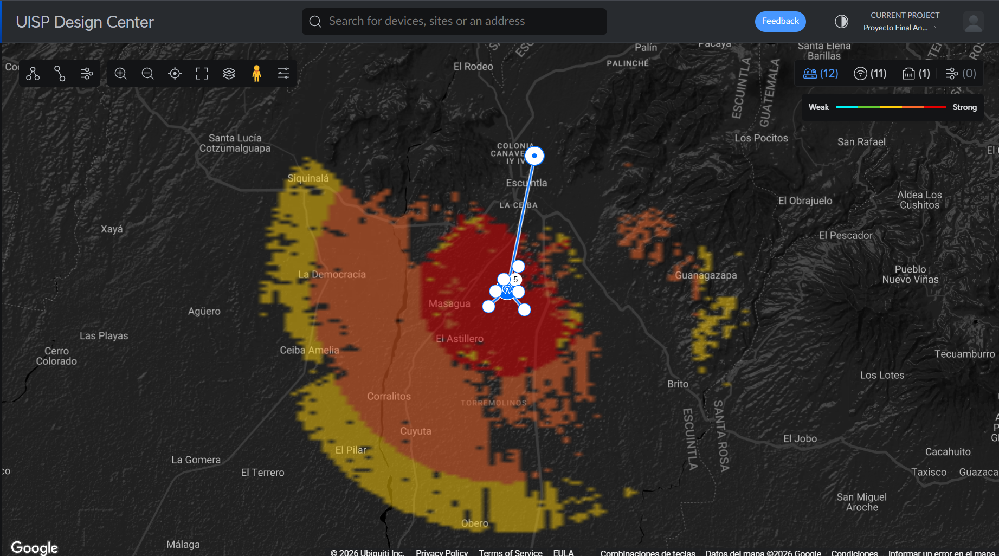<br>
      <sub>Enlace Backhaul PtP (11.94 km) desde PoP-Escuintla hasta Tower 1 y cobertura trisectorial de 360° sobre la Aldea El Milagro.</sub>
    </td>
    <td align="center" width="50%">
      <b>Cartografía 3D en Google Earth (Archivo KML)</b><br><br>
      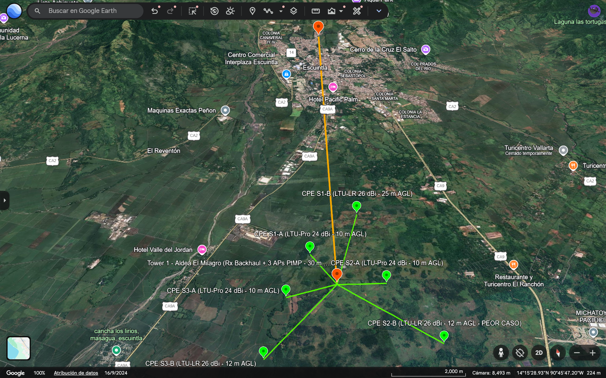<br>
      <sub>Georreferenciación de sitios, alturas sobre terreno (AGL) y trazado de enlaces exportados en <code>Red_FWA_Aldea_El_Milagro.kml</code>.</sub>
    </td>
  </tr>
</table>

<div align="center">
  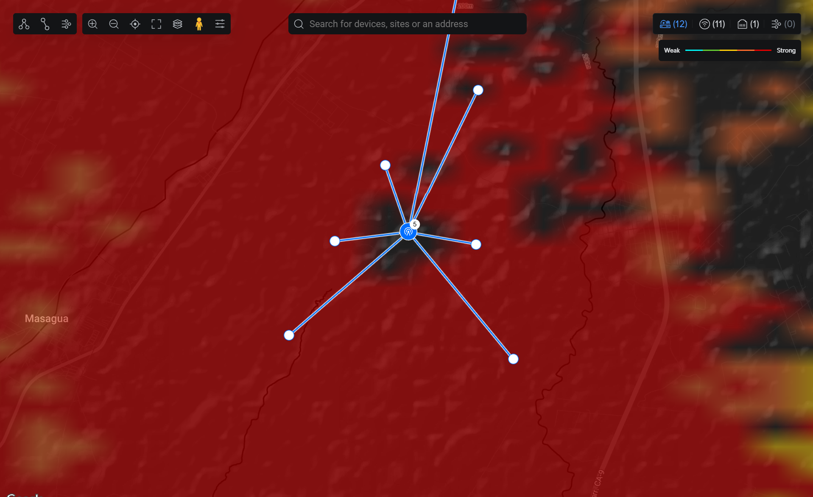<br>
  <sub>Detalle de distribución sectorial (Sectores S1=0°N, S2=120°E y S3=240°W) y estaciones CPE en la Aldea El Milagro.</sub>
</div>

---

## Resumen de la Arquitectura Extremo a Extremo (Alternativa Elegida)

El sistema conecta al **100 % de las 60 viviendas (300 habitantes)** de la **Aldea El Milagro, Masagua, Escuintla**, operando íntegramente en bandas atribuidas a los servicios **FIJO y MÓVIL en categoría Primaria (P)** según la **Tabla Nacional de Atribución de Frecuencias (TNAF, Resolución SIT-DSI-622-2020)** de Guatemala:

1. **Transporte Troncal (*Backhaul* PtP — 11.94 km en 5.2 GHz):**
   * **Origen (Tx):** Nodo PoP Fibra Óptica en Escuintla (`14.322000, -90.782000`, $430\text{ m s.n.m.}$, torre de $30\text{ m}$).
   * **Destino (Rx):** Torre Central en Aldea El Milagro (`Tower 1`: `14.216939, -90.803970`, $165\text{ m s.n.m.}$, torre de $30\text{ m}$).
   * **Equipamiento:** 2x Radios `Ubiquiti airFiber 5XHD` acoplados a reflectores parabólicos `AF-5G30-S45` ($G = 30.0\text{ dBi}$, $\varnothing = 650\text{ mm}$, $A_e = 2,129\text{ cm}^2$, $\text{HPBW} = 5.8^\circ$, polarización Dual-Slant $\pm 45^\circ$).
   * **Desempeño:** Canal de $80\text{ MHz}$ ($f_c = 5200\text{ MHz}$), despeje del **297 % de la 1ra zona de Fresnel**, señal recibida de **$-46\text{ dBm}$** ($-47.90\text{ dBm}$ analítico) y capacidad útil de **909 Mbps**.
2. **Distribución Local (*Acceso FWA* PtMP Trisectorial $360^\circ$ en 5.8 GHz):**
   * **Estación Base (`Tower 1` a 30 m AGL):** 3x Radios `Ubiquiti LTU-Rocket` acoplados a antenas sectoriales de apertura variable `airMAX Titanium AM-V5G-Ti` configuradas a $\text{HPBW}_H = 120^\circ$ ($G = 19.0\text{ dBi}$, $\text{HPBW}_V = 4.0^\circ$ mediante arreglo colineal de $N=12$ parches microstrip espaciados a $0.72\lambda$, $F/B = 30\text{ dB}$).
   * **Canalización con Banda de Guarda:** Sector 1 Norte ($0^\circ$, $5745\text{ MHz}$), Sector 2 Sureste ($120^\circ$, $5795\text{ MHz}$) y Sector 3 Suroeste ($240^\circ$, $5845\text{ MHz}$) con canales de $40\text{ MHz}$ y capacidad de **470 Mbps por sector (1,410 Mbps agregados)**.
3. **Terminales de Suscriptor (CPEs en Techos) y Red Interior:**
   * **Enlaces cortos y medios ($\le 1.3\text{ km}$, 36 viviendas):** Panel planar integrado `Ubiquiti LTU-Pro` ($G = 24.0\text{ dBi}$, $\text{HPBW} = 14^\circ$, $A_e = 534.8\text{ cm}^2$).
   * **Enlaces de borde ($1.3\text{ a }2.3\text{ km}$, 24 viviendas):** Reflector parabólico `Ubiquiti LTU-LR` ($G = 26.0\text{ dBi}$, $\text{HPBW} = 11^\circ$, $A_e = 847.5\text{ cm}^2$).
   * **Acceso Wi-Fi Residencial (60 viviendas):** Router interior `Ubiquiti airCube ISP (ACB-ISP)` en $2.4\text{ GHz}$ ($G = 4.0\text{ dBi}$, $2\times 2\text{ MIMO}$).

---

## Simulación Electromagnética de Antenas y Patrones de Radiación (GNU Octave + Datasheets)

Modelado numérico ejecutado en `generar_patrones_antenas.m` para evaluar los cortes Horizontal (Azimut) y Vertical (Elevación), la relación física entre apertura efectiva ($A_e$) y ancho de haz ($\text{HPBW}$), y la compresión del haz de elevación mediante el Factor de Arreglo ($N=12$):

<table>
  <tr>
    <td align="center" width="50%">
      <b>Cortes de Radiación H y V de las 4 Familias</b><br><br>
      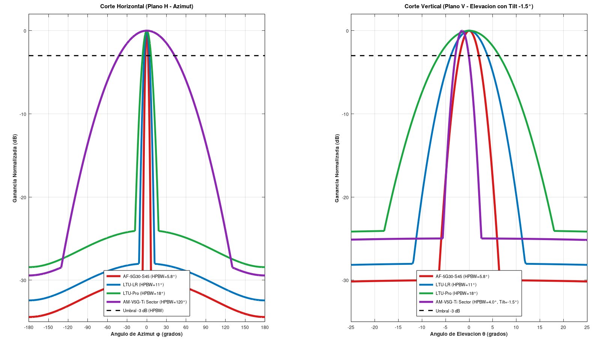<br>
      <sub>Comparación en plano azimutal y de elevación para <code>AF-5G30-S45</code>, <code>AM-V5G-Ti</code>, <code>LTU-Pro</code> y <code>LTU-LR</code>.</sub>
    </td>
    <td align="center" width="50%">
      <b>Apertura Efectiva (Ae) vs. Ganancia y HPBW</b><br><br>
      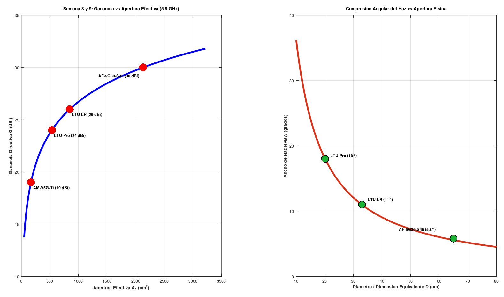<br>
      <sub>Escalamiento de la ganancia directiva y compresión angular del haz principal a 5.8 GHz.</sub>
    </td>
  </tr>
  <tr>
    <td align="center" width="50%">
      <b>Síntesis del Factor de Arreglo Vertical (N = 12)</b><br><br>
      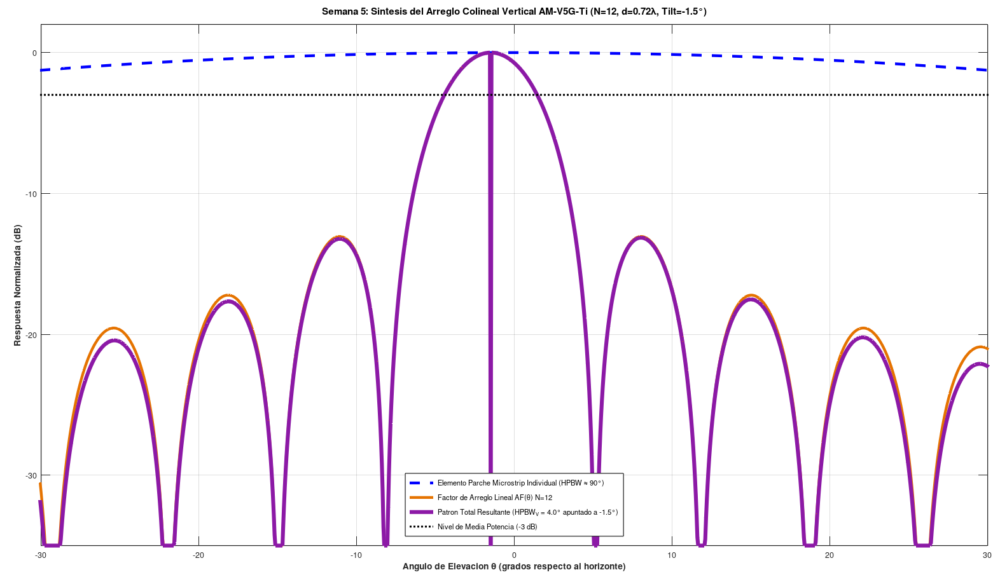<br>
      <sub>Multiplicación de patrones en <code>AM-V5G-Ti</code> (12 parches a 0.72λ con downtilt de -1.5°) para lograr HPBW_V = 4.0°.</sub>
    </td>
    <td align="center" width="50%">
      <b>Diagrama Polar de Cobertura 360° en Tower 1</b><br><br>
      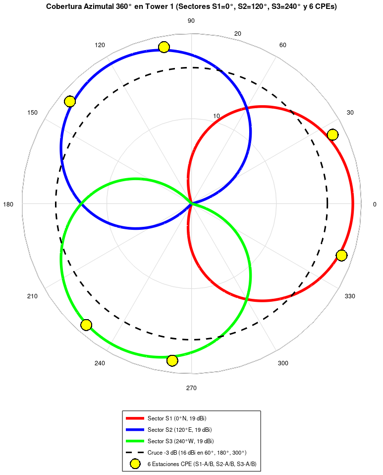<br>
      <sub>Superposición de los 3 sectores de 120° con cruces a -3 dB (16 dBi) y ubicación angular de las 6 estaciones CPE.</sub>
    </td>
  </tr>
  <tr>
    <td align="center" width="50%">
      <b>Patrones Oficiales AF-5G30-S45 (Datasheet Pág. 9)</b><br><br>
      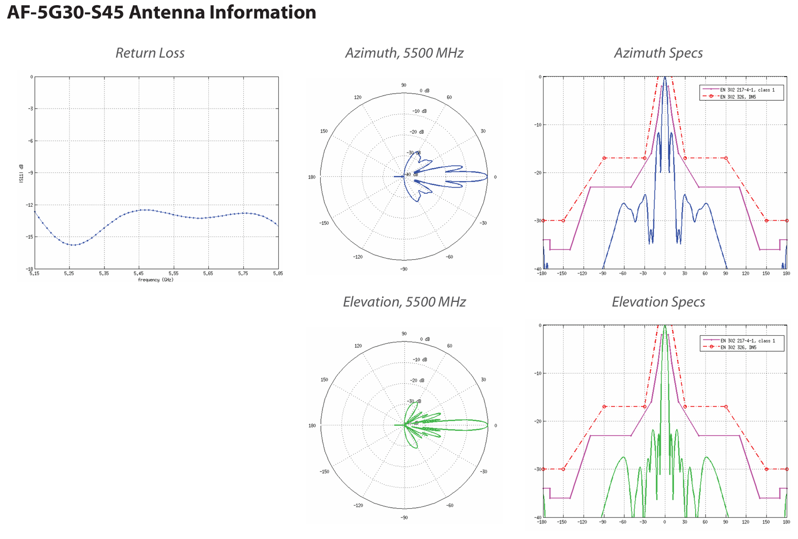<br>
      <sub>Diagramas polares oficiales y pérdida de retorno del reflector parabólico de 30 dBi.</sub>
    </td>
    <td align="center" width="50%">
      <b>Patrones Oficiales AM-V5G-Ti (Datasheet Pág. 9)</b><br><br>
      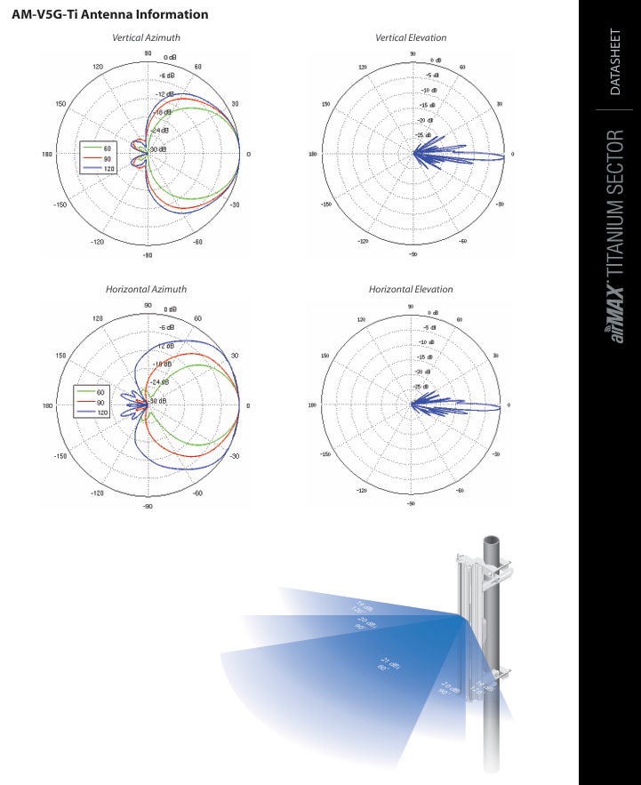<br>
      <sub>Diagramas polares H/V oficiales de la antena sectorial Titanium configurada a 120° (19 dBi).</sub>
    </td>
  </tr>
</table>

---

## Simulación de Perfiles Topográficos y Primera Zona de Fresnel (UISP Design Center)

### 1. Enlace Troncal Backhaul PtP (PoP-Escuintla $\rightarrow$ Tower 1 — 11.94 km)

<div align="center">
  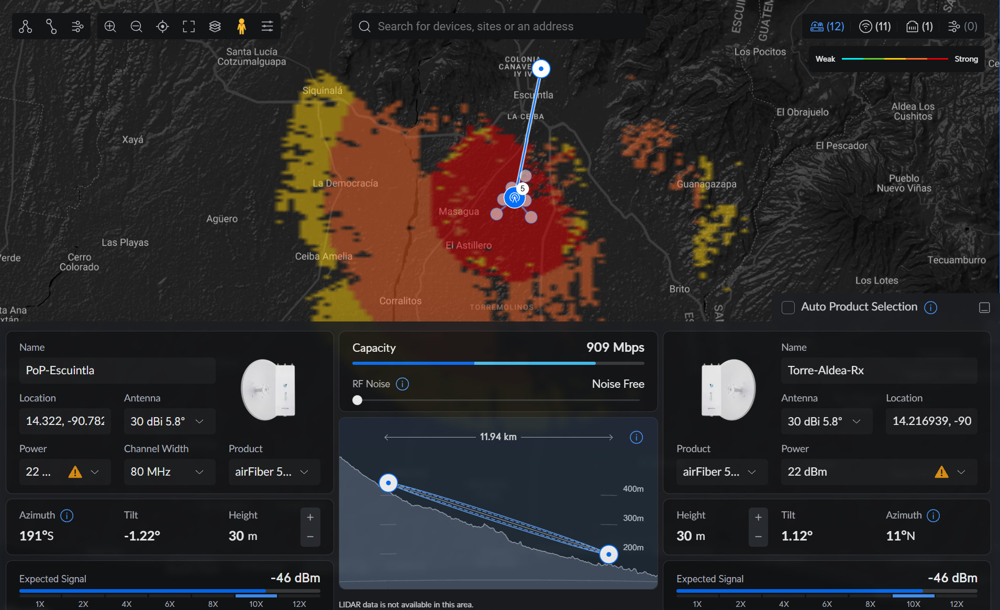<br>
  <sub>Perfil topográfico cóncavo de 11.94 km en 5.2 GHz (canal 80 MHz): despeje del 297 % de la 1ra zona de Fresnel, señal esperada de -46 dBm y capacidad de 909 Mbps.</sub>
</div>

<br>

### 2. Perfiles de Elevación de las 6 Estaciones Receptoras (CPEs en Sectores S1, S2 y S3)

<table>
  <tr>
    <td align="center" width="50%">
      <b>Sector 1 — Estación Cercana S1-A (997.27 m)</b><br><br>
      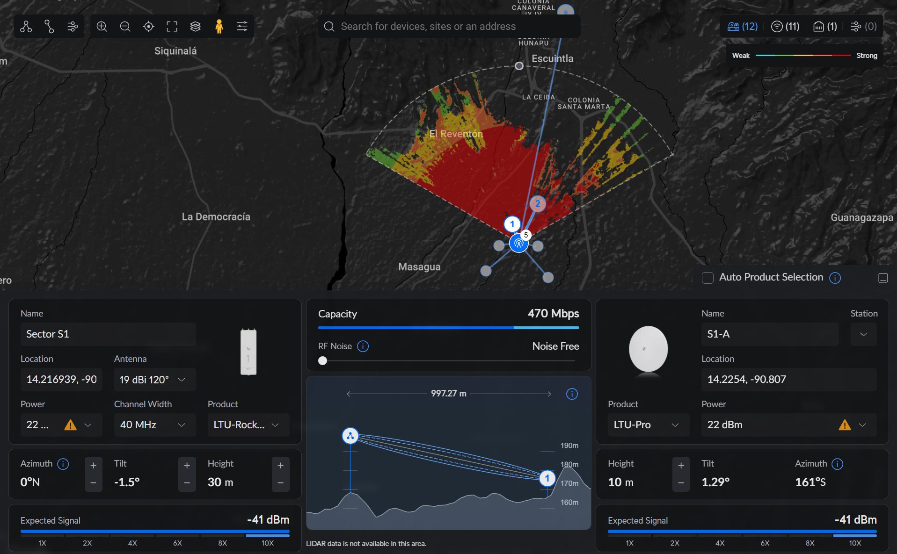<br>
      <sub>CPE <code>LTU-Pro</code> (24 dBi, h = 10 m) · Señal: -41 dBm · Cap.: 470 Mbps.</sub>
    </td>
    <td align="center" width="50%">
      <b>Sector 1 — Estación de Borde S1-B (2.21 km)</b><br><br>
      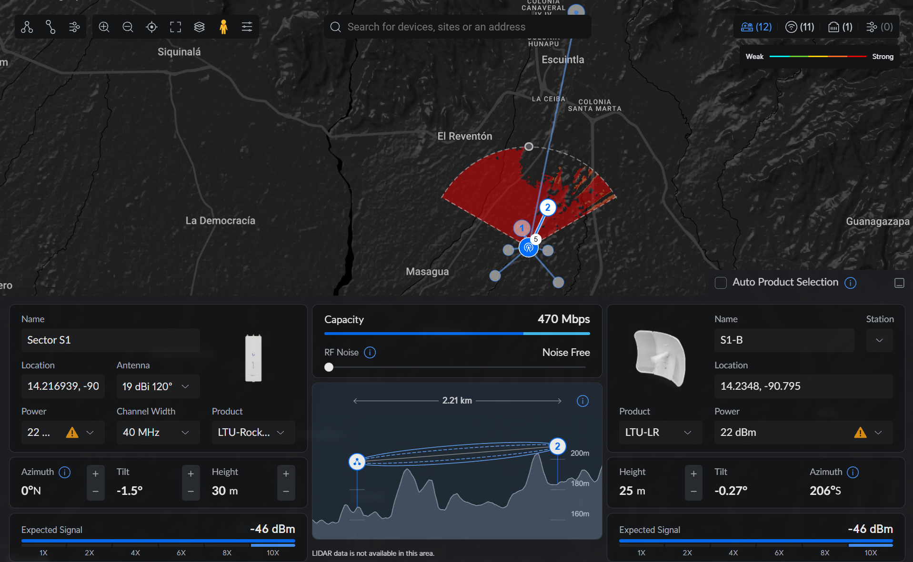<br>
      <sub>CPE <code>LTU-LR</code> (26 dBi, mástil h = 25 m para librar loma en km 1.70) · Señal: -46 dBm · Cap.: 470 Mbps.</sub>
    </td>
  </tr>
  <tr>
    <td align="center" width="50%">
      <b>Sector 2 — Estación Más Corta S2-A (962.01 m)</b><br><br>
      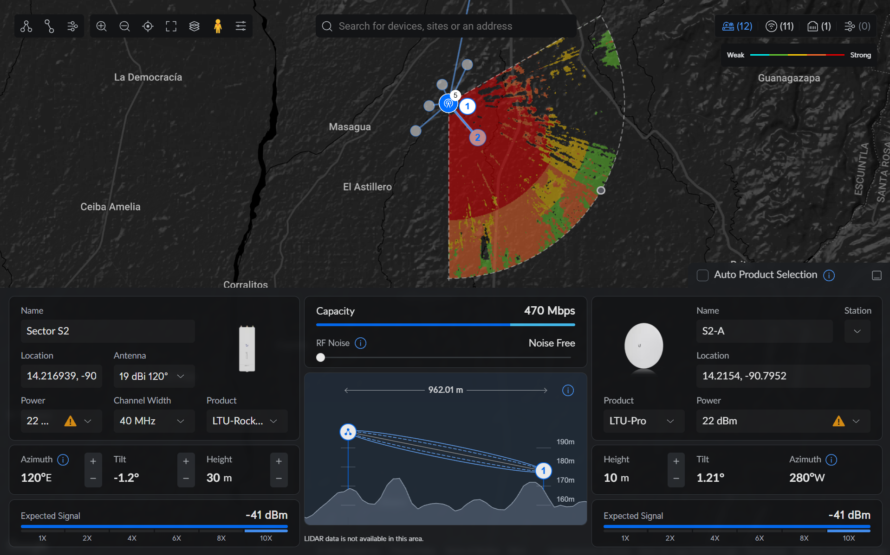<br>
      <sub>CPE <code>LTU-Pro</code> (24 dBi, h = 10 m) · Señal: -41 dBm · Cap.: 470 Mbps.</sub>
    </td>
    <td align="center" width="50%">
      <b>Sector 2 — Peor Caso / Enlace Más Largo S2-B (2.30 km)</b><br><br>
      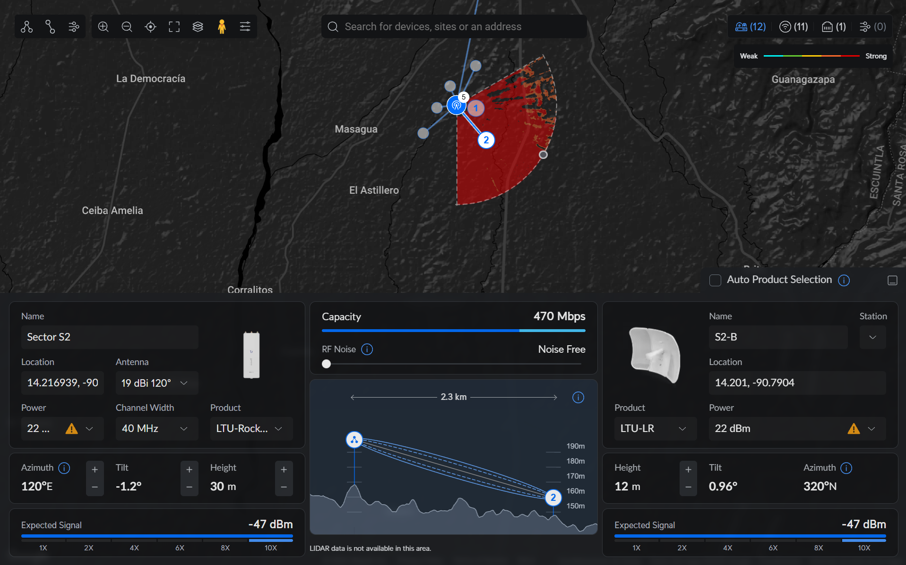<br>
      <sub>CPE <code>LTU-LR</code> (26 dBi, h = 12 m) · Señal: -47 dBm · Cap.: 470 Mbps.</sub>
    </td>
  </tr>
  <tr>
    <td align="center" width="50%">
      <b>Sector 3 — Estación Cercana S3-A (1.04 km)</b><br><br>
      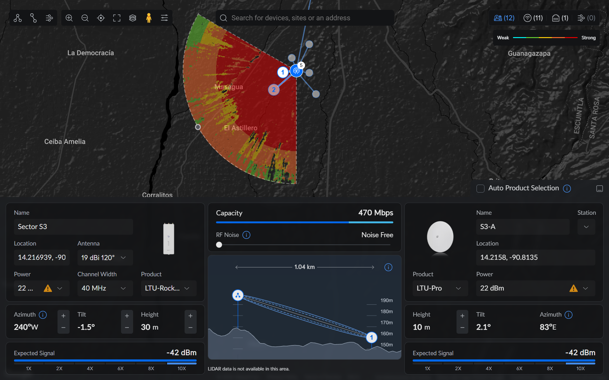<br>
      <sub>CPE <code>LTU-Pro</code> (24 dBi, h = 10 m) · Señal: -42 dBm · Cap.: 470 Mbps.</sub>
    </td>
    <td align="center" width="50%">
      <b>Sector 3 — Estación de Borde S3-B (2.20 km)</b><br><br>
      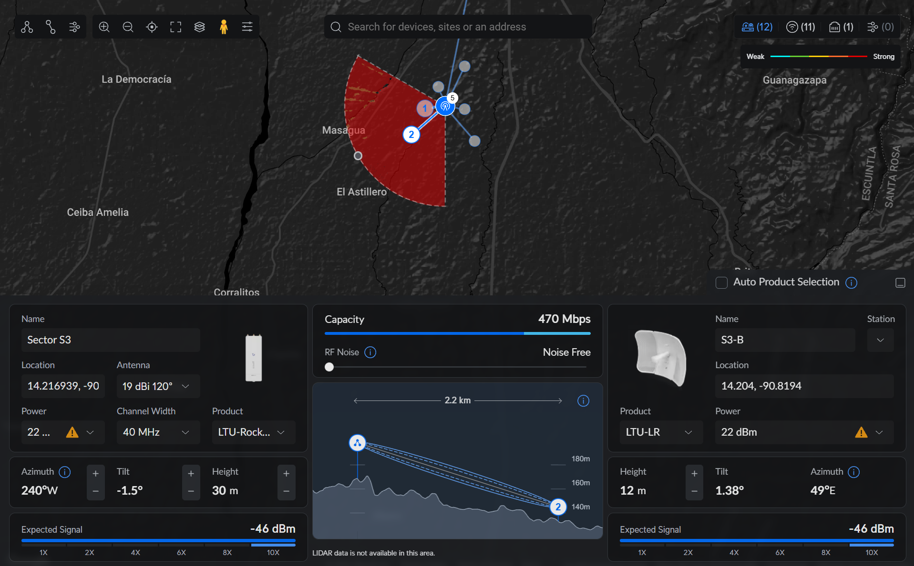<br>
      <sub>CPE <code>LTU-LR</code> (26 dBi, h = 12 m) · Señal: -46 dBm · Cap.: 470 Mbps.</sub>
    </td>
  </tr>
</table>

---

## Tabla Consolidada de Resultados Radioeléctricos y Financieros

| Indicador de Ingeniería | Meta de Diseño | Resultado Obtenido | Estado |
| :--- | :---: | :---: | :---: |
| **Cobertura de Viviendas (300 hab.)** | $100\%$ ($60\text{ hogares}$) | **60 de 60 viviendas** ($20/\text{sector}$) | ✅ **CUMPLE** |
| **Despeje Mínimo 1ra Zona de Fresnel ($r_1$)** | $\ge 60\%$ de $r_1$ | **235 %** (en `S1-B` con mástil de $25\text{ m}$) a **514 %** | ✅ **CUMPLE** |
| **Potencia Recibida en Peor Enlace (`S2-B`, 2.30 km)** | $\ge -60.0\text{ dBm}$ | **$-47.0\text{ dBm}$ UISP** ($-49.43\text{ dBm}$ analítico) | ✅ **CUMPLE** |
| **Margen de Desvanecimiento en Modulación 10X (1024-QAM)** | $\ge +12.0\text{ dB}$ | **$+13.10\text{ dB}$ (BH)** a **$+20.14\text{ dB}$ (`S2-A`)** | ✅ **CUMPLE** |
| **Capacidad Backhaul vs. Demanda Hora Pico** | $\ge 554.4\text{ Mbps}$ | **909 Mbps** ($61.0\%$ de utilización en hora pico) | ✅ **CUMPLE** |
| **Capacidad Acceso PtMP vs. Demanda Hora Pico** | $\ge 184.8\text{ Mbps/sec}$ | **470 Mbps/sector** ($1,410\text{ Mbps}$ totales) | ✅ **CUMPLE** |
| **Inversión Inicial Total (CAPEX)** | Viabilidad rural | **Q 335,000.00** (**Q 5,583.33 / hogar**) | ✅ **CUMPLE** |
| **Costo Operativo Recurrente (OPEX Mensual)** | Sostenibilidad local | **Q 6,900.00 / mes** (**Q 115.00 / hogar / mes**) | ✅ **CUMPLE** |

---

## Estructura del Repositorio

```text
Proyecto-Final-Antenas-UNIS-2026/
 ┣ 01_Informe_LaTeX/
 ┃ ┣ main.tex                                              # Código fuente completo en LaTeX (Overleaf)
 ┃ ┣ Informe_Final_Antenas_El_Milagro_UNIS.pdf             # Informe Técnico Final compilado (Entregable 1)
 ┃ ┗ escudo.png                                            # Escudo oficial UNIS para la portada 
 ┣ 02_Memoria_Calculos_Excel/
 ┃ ┗ Memoria_Calculos_Antenas_El_Milagro_UNIS2026.xlsx     # 6 Tablas Maestras con fórmulas vivas (Entregables 2 y 6)
 ┣ 03_Simulacion_GNU_Octave/
 ┃ ┣ generar_patrones_antenas.m                            # Script en GNU Octave/MATLAB para patrones H/V y Factor de Arreglo
 ┃ ┣ fig_octave_cortes_hv_familias.png                     # Gráfica de cortes H y V de las 4 familias directivas
 ┃ ┣ fig_octave_factor_arreglo_sectorial.png               # Síntesis del arreglo colineal N=12 (AM-V5G-Ti)
 ┃ ┣ fig_octave_apertura_vs_hpbw.png                       # Relación Apertura Efectiva (Ae) vs Ganancia y HPBW
 ┃ ┗ fig_octave_cobertura_azimutal_360.png                 # Diagrama polar de cobertura 360° y ubicación de CPEs
 ┣ 04_Capturas_UISP_y_Cartografia/
 ┃ ┣ Red_FWA_Aldea_El_Milagro.kml                          # Archivo cartográfico para Google Earth Pro (Entregable 5)
 ┃ ┣ mapa_cartografico_google_earth.png                    # Mapa general en Google Earth
 ┃ ┣ fig_mapa_general_red.png                              # Mapa general Backhaul 11.94 km + Cobertura 360°
 ┃ ┣ fig_mapa_sectores_aldea.png                           # Jerarquía de dispositivos en Tower 1
 ┃ ┣ fig_perfil_backhaul_ptp.png                           # Perfil topográfico y Fresnel del Backhaul PtP
 ┃ ┗ fig_perfil_s1a.png ... fig_perfil_s3b.png             # Perfiles de elevación de las 6 estaciones CPE
 ┣ 05_Datasheets_Oficiales/
 ┃ ┣ airFiber_Antennas_DS.pdf                              # Ficha técnica reflector AF-5G30-S45 (30 dBi)
 ┃ ┣ airMAX_Ti_Sector_DS.pdf                               # Ficha técnica sectorial AM-V5G-Ti (19 dBi 120°)
 ┃ ┣ ltu-pro.pdf                                           # Ficha técnica CPE panel LTU-Pro (24 dBi)
 ┃ ┣ ltu-lr_ds.pdf                                         # Ficha técnica CPE reflector LTU-LR (26 dBi)
 ┃ ┣ fig_datasheet_af5g30.png                              # Recorte polar oficial AF-5G30-S45 (Pág. 9)
 ┃ ┗ fig_datasheet_amv5gti.png                             # Recorte polar oficial AM-V5G-Ti (Pág. 9)
 ┣ 06_Presentacion_Defensa/
 ┃ ┗ Presentacion_Defensa_Antenas_UNIS2026.pdf             # Diapositivas para la defensa técnica (Entregable 7)
 ┗ README.md                                               # Documentación general del repositorio
